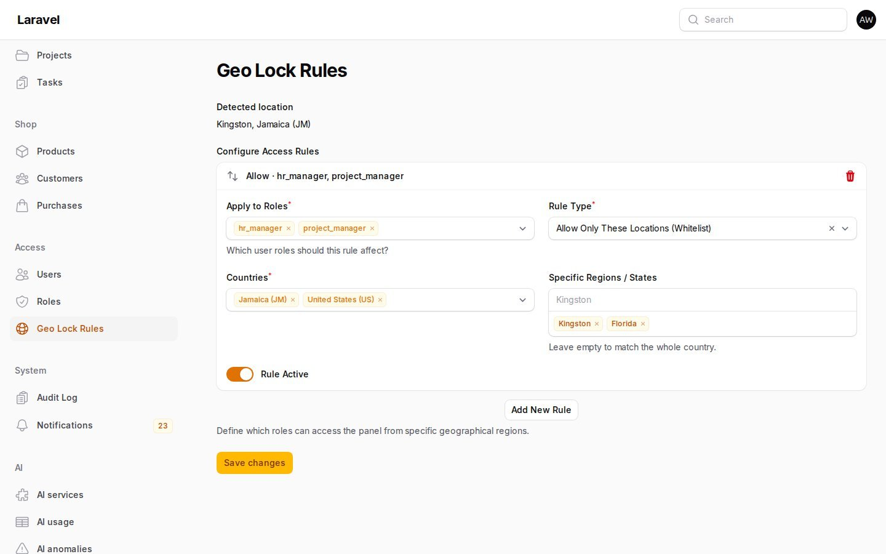

# Spiggle Geo Lock

| | |
|---|---|
| **Package** | `spiggle/geo-lock` v1.1.0 |

Decide which roles can open a Filament panel, and from where. A rule can allow a role only from chosen countries and regions, or block a role from them.

## Install

```bash
composer require spiggle/geo-lock
php artisan migrate
```

The package requires `spatie/laravel-permission`. The user model needs its `HasRoles` trait, so a rule can name the same roles the rest of the panel uses. Filament Shield is not required. The plugin supports Filament 4 and 5.

Register the plugin on the panel:

```php
use Spiggle\GeoLock\Filament\GeoLockPlugin;

$panel->plugin(GeoLockPlugin::make());
```

Open **Geo Lock Rules**. Add a rule, choose the roles, then save.



## How a visit is decided

Saved rules start collapsed. The header shows whether the rule is active and what it allows or blocks. Open a rule to edit it.

Active rules that name one of the signed-in user's roles are the only rules that apply. A user with no matching rule is unchanged. Use `*` for every role, every country, or every region. A star matches a visit even when that part of the location is unknown.

- **Allow only these locations.** The visit must match at least one allow rule for that role. A country matches the whole country unless the rule lists regions. A listed region matches that region only.
- **Block these locations.** A matching visit is denied. A block does not apply when the country or region is unknown.
- **Unknown location.** An allow rule fails closed. A block rule does not fire.
- **Bypass roles.** `super_admin` can always open the panel, including when a rule names that role. Change `bypass_roles` in `config/geo-lock.php`.
- **The rules page stays open.** A manager who is outside an allow list can still open Geo Lock Rules and fix it.

`manager_roles` controls who can see and save the rules, and who can open the denial log. The default is `super_admin`.

## Denial log

A denied visit is stored in `geo_lock_events` and shown on **Geo Lock Log**. The row keeps the user, roles, IP, country, region, and whether the visit was blocked or outside an allow list. Allowed visits are not stored. Rows older than `log_days` (default 90) are removed the next time a visit is denied. Set `GEO_LOCK_LOG_DAYS=0` to keep every row.

When `spatie/laravel-activitylog` is installed, the same denial is also written to that log under the name `geo-lock`. The package does not require it.

## Local and proxied locations

Loopback and private addresses have no public country. Set a local stand-in when you want this machine to count as a region:

```bash
GEO_LOCK_LOCAL_COUNTRY=JM
GEO_LOCK_LOCAL_REGION=Kingston
```

Public addresses are looked up at `ipwho.is` and cached for 12 hours. The visitor IP is sent to that service. Trust `X-Geo-Country`, `X-Geo-Region`, or Cloudflare's `CF-IPCountry` only when a proxy you control sets those headers and strips client-supplied copies:

```bash
GEO_LOCK_TRUST_HEADERS=true
```

## Features

- **Rules page** — roles, allow or block, countries, optional regions, and an active switch
- **Role list** — the Spatie roles already used by the panel
- **Lock page** — a denied visit shows the detected location
- **Denial log** — who was turned away, from where, and why
- **Lockout protection** — bypass roles, and the rules page itself, stay reachable

## Spiggle plugins

- **[Visual Dashboards](https://github.com/skillbobby/Spiggle-Visual-Dashboards)** — chart the records already in the app and publish the page.
- **[FilaWarden Core](https://github.com/skillbobby/Spiggle-FilaWarden-Core)** — deployment checks, queue and cron health, and production diagnostics inside Filament.
- **[Form Builder Core](https://github.com/skillbobby/Spiggle-Form-Builder-Core)** — public forms, submissions, and CSV export.
- **[Dynamic Fields Core](https://github.com/skillbobby/Spiggle-Dynamic-Fields-Core)** — custom fields on any Eloquent model.
- **[Rules Engine](https://github.com/skillbobby/Spiggle-Rules-Engine)** — event triggers you design in the panel.
- **[List View](https://github.com/skillbobby/Spiggle-List-View)** — switch a Filament table to an alphabetical list.
- **[Portal Snapshot](https://github.com/skillbobby/Spiggle-Filament-Portal-Snapshot)** — schedule, restore, and export database snapshots, including demo resets.

## Sponsors

Support the plugins at [github.com/sponsors/skillbobby](https://github.com/sponsors/skillbobby).

## Contact

[Spiggle on X](https://x.com/iamspiggle)

## License

All rights reserved. You can review this repository and install the package in your own Laravel application. See [LICENSE](LICENSE).
